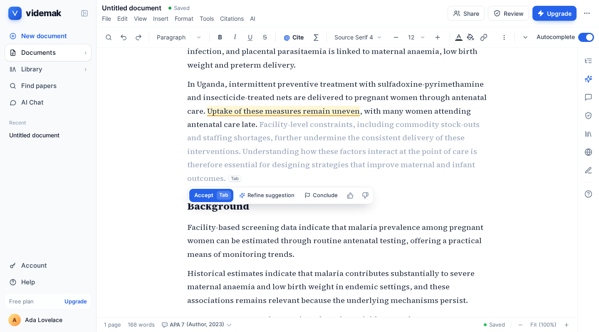

# AI for Research

**The AI editor for academic writing.** Autocomplete that cites real papers, @-cite from 250M+ scholarly works, chat with your PDFs, a careful AI reviewer, and Word, LaTeX and PDF in and out.



- **Run it:** this repo deploys to your own Firebase project (App Hosting, Firestore, Storage, Authentication, Cloud Functions) plus two small Cloud Run services.
- **Build on it:** the editor is a React package, and the [developer API](#developer-api) gives other apps papers, full text, research tools and AI through keys you issue.

---

## What's in the editor

| | |
| --- | --- |
| **Autocomplete with citations** | Suggests your next sentence and cites the papers it draws on. Accept, refine or ask it to conclude a section. |
| **Find papers and @-cite** | Search scholarly works without leaving the page; type `@` to cite one. 10,000+ citation styles. |
| **Library and chat with PDFs** | Upload or import papers, ask questions and get answers with page numbers. |
| **AI review** | Peer review, claim checks, source quality (retracted, preprint, wrong DOI), proofreading and tone, as comments in your text. |
| **Write with others** | Real-time editing, comments, suggestions (tracked changes) and version history. |
| **Word and LaTeX** | Open `.docx` files and keep their styles; export Word, PDF or a LaTeX project. |
| **On your phone** | A full editor, not a viewer. |

## What it costs to run

You pay Google Cloud for what your Firebase project uses (the free tier covers small groups) and the providers you connect: an AI provider such as DeepSeek or OpenAI, and optionally a Scholar key, Dodo Payments and an email service. You can sell plans and developer-API credits to your own users with Dodo Payments (merchant of record: it handles sales tax and receipts).

---

## Run it on Firebase

```
  Browser ──────────────► Firebase Authentication   (password, Google, Microsoft, Apple; App Check)
     │  ID token
     ├─ https ─────────►  App Hosting: Next.js app    Next.js pages + the API (/api, /v1) in route handlers
     │                       │  Admin SDK
     │                       ├──► Firestore           accounts, documents, Library, plans, credits, settings
     │                       ├──► Cloud Storage        PDFs, document blocks, Yjs state, images
     │                       └──► Cloud Run: convert   Word / PDF / LaTeX, PDF text (internal only)
     └─ wss ───────────►  Cloud Run: collab          live text (Hocuspocus/Yjs) and presence
                          Cloud Functions            PDF text on upload, Library imports, newsletter, cleanup
```

More in [docs/architecture.md](docs/architecture.md) and [docs/data-model.md](docs/data-model.md).

You need a Firebase project on the **Blaze** plan (App Hosting, Functions and Cloud Run need billing; small groups stay inside the free tier), the [Firebase CLI](https://firebase.google.com/docs/cli) and `gcloud`.

1. **Create the project** and, in the Firebase console, turn on:
   - **Authentication** › Sign-in method: Email/Password, and Google, Microsoft, Apple as you like (each provider's redirect URL is `https://<project>.firebaseapp.com/__/auth/handler`). Under **Templates**, set the action URL to `https://<your site>/auth/action` so reset and confirmation links open AI for Research's own pages. Add your domain under **Authorized domains**.
   - **Firestore** (Native mode) and **Storage**.
   - Optional: **App Check** with reCAPTCHA Enterprise, enforced for Authentication.
2. **Rules, indexes and functions:**
   ```bash
   git clone <your repository URL> && cd AI for Research
   pnpm install:all                          # the app, functions/ and tools/migrate
   cp .firebaserc.example .firebaserc        # put your project id in it
   cp functions/.env.example functions/.env  # CONVERT_URL, PUBLIC_URL
   firebase functions:secrets:set SETTINGS_KEY      # 32+ random characters; the same value as the web app's
   pnpm run deploy:firebase                          # Firestore rules + indexes, Storage rules, Cloud Functions
   ```
   Then turn on the TTL policy for `rate_limits.expires_at` (Firestore › TTL).
3. **Converter and collab on Cloud Run:** see [services/convert](services/convert/README.md) (internal ingress) and [services/collab](services/collab/README.md) (one instance, WebSockets).
4. **Web app on App Hosting:** create a backend from your GitHub repo (app root directory: the repository root). Fill in [`apphosting.yaml`](apphosting.yaml) (Firebase web config, `PUBLIC_URL`, `CONVERT_URL`, `NEXT_PUBLIC_REALTIME_URL`) and add the secrets it names:
   ```bash
   firebase apphosting:secrets:set SETTINGS_KEY
   firebase apphosting:secrets:set INTERNAL_SECRET
   firebase apphosting:secrets:set LLM_API_KEY      # and SCHOLAR_API_KEY, DODO_PAYMENTS_API_KEY, … as you use them
   ```
   Every push to the branch deploys. All settings live there and in Secret Manager; plans and prices are in code ([`plans.ts`](lib/server/lib/plans.ts), [`prices.ts`](lib/server/lib/prices.ts)). There is no admin page.

**Coming from the Postgres (Docker) version of this app?** [tools/migrate](tools/migrate/README.md) copies Postgres and the files into Firestore, Storage and Firebase Auth. People keep their ids and their passwords.

### What changed from the Postgres version

- **No Docker install.** The app runs on your Firebase project instead of one server. There is no `docker compose` any more.
- **Sign-in is Firebase Authentication.** Passwords, Google, Microsoft and Apple work as before. **Passkeys are gone** (Firebase has none), and **Cloudflare Turnstile is replaced by App Check**. Firebase sends the reset and confirmation emails.
- **Search is word-based.** Firestore has no full-text index. Documents and Library passages match on their words; turn on `EMBEDDINGS_PROVIDER` for Library vector search, or add Typesense or Algolia for ranked full-text search.
- **Background work runs in Cloud Functions** (PDF text, imports, newsletter), so nothing is lost when a request ends.
- **Live editing is its own service** (`services/collab`) and runs on one Cloud Run instance for now.

### Connect services

Each service is a slot with its own provider. Set them in `apphosting.yaml` (secrets in Secret Manager) and redeploy.

| Slot | Options | Settings |
| --- | --- | --- |
| **AI** | OpenRouter running DeepSeek (default), DeepSeek API, OpenAI, Anthropic, Ollama | `LLM_PROVIDER`, `LLM_API_KEY`, `LLM_MODEL`, `LLM_REVIEW_MODEL`, `LLM_BASE_URL` |
| **Papers** | [CitedEvidence Scholar](#papers-from-scholar) (default), OpenAlex | `PAPERS_PROVIDER`, `SCHOLAR_API_KEY`, `OPENALEX_EMAIL` |
| **Library search** | Word search, or embeddings with Firestore vector search: from the converter's own model (`local`, no per-token fees) or OpenAI | `EMBEDDINGS_PROVIDER` (`local` \| `openai`), `EMBEDDINGS_API_KEY` (OpenAI only) |
| **Email** | SMTP or Resend (invitations and credit notices; Firebase sends sign-in emails itself) | `MAIL_PROVIDER`, `MAIL_FROM`, `SMTP_*`, `RESEND_API_KEY` |
| **Newsletter** | MailCheap (keeps a list in step with confirmed accounts) | `NEWSLETTER_PROVIDER`, `MAILCHEAP_API_KEY` |
| **Payments** | Dodo Payments, if you sell plans or credits yourself | `DODO_PAYMENTS_API_KEY`, `DODO_PAYMENTS_WEBHOOK_KEY`, `BILLING_LIVE=1` for live mode |
| **Sign-in** | Email and password, Google, Microsoft, Apple (Firebase Authentication), App Check | Firebase console › Authentication; on/off with `SIGNIN_PASSWORD`, `SIGNIN_GOOGLE`, `SIGNIN_MICROSOFT`, `SIGNIN_APPLE` |

[`.env.example`](.env.example) lists every setting with a short note. Files live in the project's Cloud Storage bucket.

### Payments with Dodo Payments

1. In the Dodo dashboard (test mode), create an API key and set it as `DODO_PAYMENTS_API_KEY`.
2. Add a webhook (Developer › Webhooks) to `PUBLIC_URL/api/dodo/webhook` with the events listed in [`dodoWebhook.ts`](lib/server/routes/dodoWebhook.ts), and set its secret as `DODO_PAYMENTS_WEBHOOK_KEY`.
3. That's all: the Dodo products for plans and credit packs are created on the first checkout, from the prices in code. Change a price in code and the next checkout makes a new product (current subscribers keep theirs).
4. For real payments: a live-mode key and webhook, and `BILLING_LIVE=1`.

### Papers from Scholar

Papers come from [CitedEvidence Scholar](https://scholar.citedevidence.com): 250M+ scholarly works with authors, journals and citations, plus full text and PDFs where a copy is available. It works without a key at low limits. A **free key** adds full text and research tools and comes with **1,000 free credits a day**:

1. Sign in at [scholar.citedevidence.com](https://scholar.citedevidence.com/account/api-keys) and open **API keys**.
2. Turn on **Metadata**, **Files** and **Research** for your key.
3. Set it as the `SCHOLAR_API_KEY` secret and redeploy.

If Scholar is busy, searches fall back to [OpenAlex](https://openalex.org) automatically.

---

## Developer API

Your deployment can offer its services to other apps at `/v1`: people create keys at `/developers/keys` and pay in credits (Dodo Payments). The API calls the same providers you connected above, using the upstream keys `CLOUD_DEEPSEEK_API_KEY` and `CLOUD_SCHOLAR_API_KEY`. Prices are in [`lib/server/lib/prices.ts`](lib/server/lib/prices.ts); free allowances are `CLOUD_DAILY_FREE_CREDITS` and `CLOUD_STARTER_CREDITS`.

| Service | Endpoint | Credits |
| --- | --- | --- |
| Paper search and lookups (works, authors, journals…) | `GET /v1/oa/…` | 1 per request · free daily |
| Full text and PDFs | `GET /v1/files/…` | 1 per request · free daily |
| Research tools: multi-source search, citation networks, recommendations | `POST /v1/research/tools/{name}`, `POST /v1/mcp` | 1 per call · free daily |
| Reference checks (do these DOIs and PubMed IDs exist?) | `validate_citations` | 1 per reference · free daily |
| AI (OpenAI-compatible, DeepSeek) | `POST /v1/chat/completions` | 78 input / 312 output per 1M tokens |
| AI peer review of a manuscript | `POST /v1/review` | 10 per 1,000 words |
| Word, PDF or LaTeX from editor documents | `POST /v1/convert` | 1 per file |

- **1,000 free credits every day** for the services marked *free daily*. They reset at midnight UTC.
- **100 credits to start** on your first key, to try AI, reviews and exports. Both need a confirmed email.
- **Credit packs:** 2,000 for $29.90 · 10,000 for $119 · 100,000 for $790 · 1,000,000 for $4,990. One credit is one paper or file request. Credits people buy don't expire.
- Optional automatic top-up with a monthly limit, and a monthly cap per key.

```bash
curl -H "Authorization: Bearer $WRITEORBIT_API_KEY" \
  "https://<your site>/v1/oa/works?search=sleep%20memory&per_page=5"
```

Every response reports `X-Credits-Charged` and `X-Credits-Balance`; out of credits is `402`. Research tools work in any MCP client (Claude, Cursor…) with `https://<your site>/v1/mcp` and the key as a Bearer header. Full reference: [docs/cloud-api.md](docs/cloud-api.md).

## Develop

You need Node 22, pnpm 9 and Java 21 (for the Firebase emulators).

```bash
pnpm install:all
cp .env.example .env.local     # NEXT_PUBLIC_USE_EMULATORS=1 for local work
pnpm dev:all                            # Firebase emulators (UI on :4000) + web app and API on :3000 + collab on :4200
```

`pnpm emulators` runs only the emulators; data is kept in `.emulator-data/` between runs. For Word, PDF and LaTeX, run the converter too (`services/convert`, port 4100).

Tests: `pnpm test` (Vitest: the API and collab), `pnpm test:rules` (security rules against the emulator), `pytest` in `services/convert`, and browser tests in [`tests/e2e`](tests/e2e).

The repository root is the Next.js app (Next.js 15, React 19, Tailwind 4, Firebase Authentication), deployed to App Hosting. The parts that run elsewhere have their own folders.

| Folder | What it is |
| --- | --- |
| `app` | Pages, plus the API's two route handlers, `app/api/[[...route]]` and `app/v1/[[...route]]`. |
| `components` | The site and app components. |
| `components/editor` | The editor (BlockNote + Yjs), mounted with `<WriteOrbitEditorProvider config={…}>`. |
| `lib` | Browser helpers (Firebase, session, sign-in). |
| `lib/server` | The API (Hono) and data layer on Firestore and Storage: plans, credits, AI and papers slots, the developer API (/v1) and the background jobs. Server-only. |
| `public` | Static files. |
| `tests/server` | API unit tests (Vitest). `tests/rules`: security rules. `tests/e2e`: browser tests. |
| `services/collab` | Live text (Hocuspocus) and presence over WebSockets, on Cloud Run. Uses the root's packages and bundles `lib/server` (`pnpm build:collab`). |
| `services/convert` | Word, LaTeX and PDF converter (Python: FastAPI, LibreOffice, pypdfium2), on Cloud Run. |
| `functions` | Cloud Functions: Storage, Firestore, Auth and scheduled triggers. Its own `package.json`; bundles `lib/server` (`pnpm build:functions`). |
| `tools/migrate` | Copies a Postgres install of this app into Firebase. Its own `package.json`. |
| `scripts` | `dev.mjs`, which `pnpm dev:all` uses to run the app and collab together. |
| `firestore.rules`, `firestore.indexes.json`, `storage.rules`, `firebase.json` | The Firebase project's configuration. |

See [CONTRIBUTING.md](CONTRIBUTING.md) to send a change and [SECURITY.md](SECURITY.md) to report a vulnerability.

## Licence

Copyright © 2026 AI for Research. All rights reserved. This is proprietary software; it is not licensed for use, copying or distribution without written permission.

Third-party software and the code this project is derived from are credited, with their licences, in [NOTICE](NOTICE).
