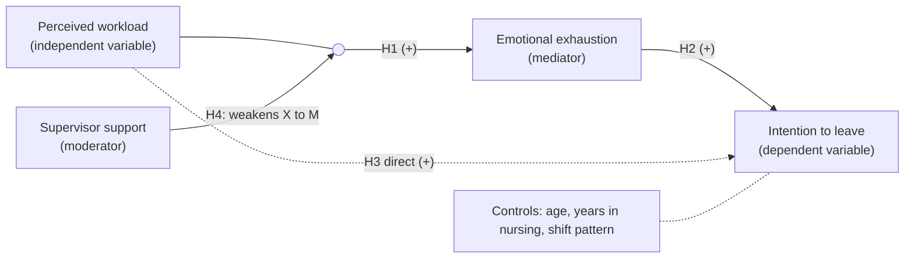
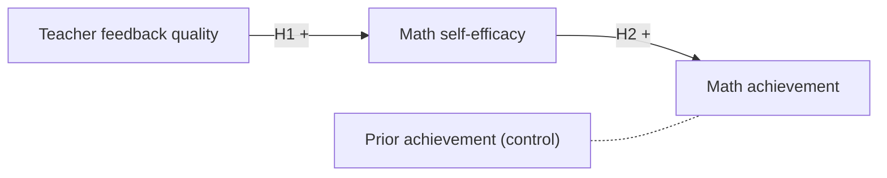

# How to draw a conceptual framework diagram

*Last updated: 13 November 2026*

A conceptual framework diagram shows the concepts or variables in your study as labeled boxes and the relationships you expect between them as arrows. To draw one, list the variables from your research question, place the independent variables on the left and the outcome on the right, draw an arrow for each hypothesized relationship and label it, put mediators in the chain between them, point moderators at the arrow they change, and list controls separately. Keep it to what your study measures.

This post is about drawing the diagram. For what a conceptual framework is and how it differs from a theoretical one, read [theoretical vs conceptual framework](/blog/theoretical-vs-conceptual-framework) first. It is part of our series on writing and publishing papers; the pillar is [how to write a conference paper](/blog/how-to-write-a-conference-paper).

## The building blocks

Most quantitative framework diagrams use a small set of shapes and lines. Use them the same way throughout.

| Element | How to draw it | What it means |
| --- | --- | --- |
| **Box** | Rectangle with the variable's name | A concept or variable you measure |
| **Solid arrow** | From cause to effect | A relationship you hypothesize and test |
| **Dashed arrow** | From cause to effect | A relationship you expect but do not test, or a direct effect alongside a mediated one |
| **Arrow label** | H1, H2, often with + or - | Which hypothesis tests it, and the expected direction |
| **Mediator** | A box in the chain: X to M to Y | The mechanism through which X affects Y |
| **Moderator** | A box with an arrow pointing at the middle of another arrow | Changes the strength or direction of that relationship |
| **Control box** | A separate box, often with a dashed border | Variables held constant in the analysis |
| **Grouping frame** | A larger rectangle around several boxes | Variables at one level (individual, team, organization) or one theme |

Two rules matter more than any styling:

1. **Every box must be something you measure or discuss.** If it appears in the diagram, your methodology should say how it is measured; see [operational definition of variables](/blog/operational-definition-of-variables).
2. **Every solid arrow must match a hypothesis or research question.** If you have H1 to H4, you should be able to point to four arrows. Our guide on [how to write a hypothesis](/blog/how-to-write-a-hypothesis) helps you word them.

## Mediators vs moderators in a diagram

These two are the most common source of confusion, and examiners notice when they are drawn wrongly.

- **A mediator** explains *how* or *why* X affects Y. It sits between them: X → M → Y. If you also expect a direct effect of X on Y, draw it as a separate arrow, often dashed.
- **A moderator** explains *when* or *for whom* X affects Y. It does not sit in the chain. Its arrow points to the arrow between X and Y, not to either box.

*Example (invented for illustration):* workload increases emotional exhaustion (X → M), which increases intention to leave (M → Y). Supervisor support weakens the effect of workload on exhaustion, so it moderates the X → M arrow.

## Step by step

1. **List the variables** from your research question and hypotheses. Write each as a short noun phrase: "Perceived workload", not "How much work nurses feel they have".
2. **Classify each one:** independent, dependent, mediator, moderator or control.
3. **Arrange left to right.** Causes on the left, outcomes on the right, mediators in between, moderators above or below the arrow they act on.
4. **Draw the arrows** for each hypothesis and label them H1, H2 and so on, with the expected sign.
5. **Add controls** in a separate box, not as arrows to every variable.
6. **Simplify.** Remove crossing lines by rearranging boxes. Aim for one page, readable when printed at half-page width.
7. **Write the caption:** "Figure 2.1. Conceptual framework of the study," with a note on what solid and dashed lines mean, and the theory it draws on if there is one.
8. **Check it against the methodology.** Each box should map to a measure; each arrow to an analysis.

## A Mermaid example to copy

Mermaid is a text format that turns a few lines into a diagram. Many editors and documentation tools render it, and you can export the result as SVG or PNG. This is the nursing example above:

*Example (invented).* Mermaid cannot point an arrow at another arrow, so the small empty circle `J` acts as a junction on the X → M path, and the moderator's arrow points at it. That keeps the standard convention. `-->` draws a solid arrow, `-.->` a dashed one, and the text between pipes is the label.

A simpler, purely structural framework, for example in education:

## Other ways to draw it

| Tool | Good for | Watch out for |
| --- | --- | --- |
| PowerPoint or Word shapes | Quick drawing, easy edits by supervisors | Use connectors that stay attached; export as PDF or EMF, not a screenshot |
| diagrams.net (draw.io) | Free, precise alignment, SVG export | Keep the source file with your thesis files |
| LaTeX with TikZ | Theses written in LaTeX, consistent fonts | Slower to adjust layout |
| Mermaid | Diagrams kept as text, easy to version | Limited control of exact placement |
| Structural equation modeling software | Path diagrams with estimates after analysis | That is a results figure, not your framework |

## Qualitative and mixed methods frameworks

A qualitative framework is not a set of hypotheses, so causal arrows can mislead. Common alternatives:

- **Nested circles** for levels of influence (individual inside community inside policy), as in socio-ecological models.
- **Overlapping shapes** for concepts that interact.
- **A process flow** for stages of an experience, with two-way arrows where stages loop.

Say in the caption that the framework guides the inquiry and may be revised by what the data show. For mixed methods, a diagram can show which strand addresses which part of the framework.

## Common mistakes

- **Drawing the literature review,** with every concept you read about, instead of what your study measures.
- **Moderators pointing at a box** instead of the relationship they change.
- **Mediators drawn beside the chain** rather than in it.
- **Arrows without labels,** so the reader cannot match them to hypotheses.
- **Two-headed arrows used loosely.** A double-headed arrow means a correlation, not "these are related somehow".
- **Inconsistent names:** "Job stress" in the diagram, "Occupational stress" in the questionnaire, "Stress" in the results.
- **A screenshot pasted into the thesis,** blurry when printed. Export a vector file.
- **Repeating the theory diagram** from the original author without adapting it to your variables and setting.

## Draw the diagram in AI for Research

The editor has a **Mermaid diagram block** for flowcharts, conceptual frameworks and study designs. You can write or paste the Mermaid text yourself and export the diagram as SVG or PNG. Drawing by hand is free. **Draw with AI** turns a description such as "workload to exhaustion to intention to leave, moderated by supervisor support, with age as a control" into a first diagram for 1 credit, which you then edit. You can also use it from the Thesis Suite framework module. The Free plan has 45 credits a month; see [pricing](/pricing).

<!-- SCREENSHOT: Editor with a Mermaid diagram block showing a conceptual framework with a mediator and a moderator, and the SVG/PNG export menu open -->

The diagram shows what you tell it; it does not decide your hypotheses or check that your theory supports them. To turn each box into a measurable variable, the [variable operationalization](/features/variable-operationalization) module in Thesis Suite builds a table of definitions, indicators, instruments and measurement levels. See the [scientific diagrams](/features/scientific-diagrams) page for more.

## FAQ

### What should a conceptual framework diagram include?

The concepts or variables your study examines, shown as labeled boxes, and the relationships you expect between them, shown as arrows. Quantitative diagrams usually mark the independent and dependent variables, any mediators and moderators, and the hypothesis each arrow tests. Control variables can be listed in a separate box. Nothing should appear that the study does not measure or discuss.

### How do you show a moderator in a conceptual framework diagram?

Draw an arrow from the moderator to the middle of the arrow it changes, not to a variable. That shows the moderator changes the strength or direction of the relationship. A mediator, by contrast, sits between the two variables in the chain: an arrow from the independent variable to the mediator and another from the mediator to the outcome.

### What software can I use to draw a conceptual framework diagram?

PowerPoint, Word's shapes, diagrams.net (draw.io), Lucidchart, LaTeX with TikZ, and text-to-diagram tools such as Mermaid all work. Choose one that exports a vector format (SVG or PDF) so the diagram stays sharp in the thesis, and that a co-author or supervisor can edit.

### Can a qualitative study have a conceptual framework diagram?

Yes. A qualitative framework diagram usually shows the concepts that sensitize the analysis and how they may relate, often as overlapping or nested shapes rather than causal arrows. Label it as a guide to the inquiry, not a set of hypotheses, and revise it if the data suggest a different picture.

### Where does the diagram go in a thesis?

Usually at the end of the literature review or in a framework section before the methodology, as a numbered figure with a caption, introduced in the text before it appears. Refer to it again in the methodology, where each box becomes a measured variable, and in the discussion.

## Related

- [Theoretical vs conceptual framework](/blog/theoretical-vs-conceptual-framework)
- [Operational definition of variables](/blog/operational-definition-of-variables)
- [How to write a hypothesis](/blog/how-to-write-a-hypothesis)
- [How to write a methodology chapter](/blog/how-to-write-a-methodology-chapter)
- [How to make a research poster](/blog/how-to-make-a-research-poster)
